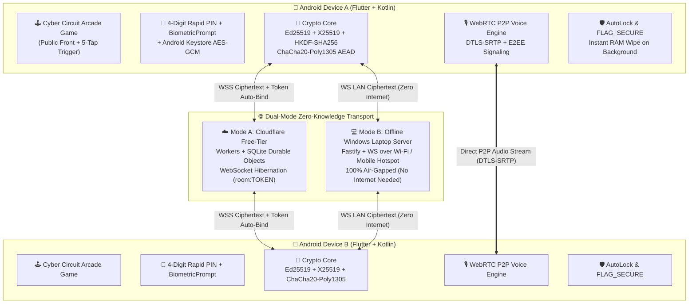

<div align="center">

# 🕹️🔐 SecretPlay
### **The Dual-Persona, Zero-Trace Encrypted Messenger & P2P Voice Vault for Two**
*An innocent Cyberpunk Arcade Game on the outside. A hardware-locked, zero-disk E2EE communication suite on the inside.*

[](https://github.com/saayedh/SecretPlay/actions/workflows/build-android.yml)
[](https://github.com/saayedh/SecretPlay/releases/tag/v1.0.0)
[](https://developers.cloudflare.com/durable-objects/)
[](https://flutter.dev)
[](https://webrtc.org/)
[-FF2A85)](#zero-trace-ephemeral-architecture)

<br/>

[**📲 Download Direct Android APK (`arm64-v8a`)**](https://github.com/saayedh/SecretPlay/releases/download/v1.0.0/app-arm64-v8a-release.apk) · [**📦 All Releases**](https://github.com/saayedh/SecretPlay/releases/tag/v1.0.0) · [**🛡️ Security Architecture**](docs/ARCHITECTURE.md) · [**🔬 Threat Model**](docs/THREAT_MODEL.md) · [**🇮🇷 راهنمای فارسی**](#-راهنمای-سریع-فارسی-persian-quick-guide)

</div>

---

## ⚡ Why SecretPlay Exists

Every mainstream "secure" messenger—Signal, WhatsApp, Telegram—suffers from four fundamental metadata and physical-access leaks:
1. **Public Discovery & Phone Numbers:** They tie your identity to a SIM card, central directory, or public username.
2. **On-Device Forensic Databases:** Even with E2EE in transit, decrypted messages are written to on-device SQLite databases (`msgstore.db`) where physical seizure or spyware can extract years of history.
3. **Always-On Cloud Dependency:** When the internet goes dark or is throttled, cloud-only messengers stop working.
4. **Visual Footprint:** Having a known private messenger icon on your home screen or recent-apps switcher invites unwanted scrutiny.

**SecretPlay** flips the paradigm. Engineered exclusively for **two people** (two authorized Android devices per room token):
* 🎮 **Persona 1 (Public Front):** Launches as **Cyber Circuit**, a fully playable, 60fps 7×7 match-3 cyberpunk puzzle game with 15 sector levels, combo multipliers, and persistent high scores.
* 🔐 **Persona 2 (Hidden Vault):** Tap the title header **5 times** → enter your **4-digit rapid PIN** (auto-unlocks on the 4th digit or via **Android Biometric Fingerprint**) → enter your **Shared Pair Token** (e.g., `SP-4829-K7`) → instant **X25519 + Ed25519 + ChaCha20-Poly1305** text chat and **P2P WebRTC DTLS-SRTP** encrypted voice calls.
* 💨 **Zero-Disk RAM-Only Existence:** The moment you press the **Home button**, switch apps, lock your screen, or tap **Panic Wipe**, your session keys and chat history are **cryptographically obliterated from RAM in `< 50ms`** and the app snaps back to the arcade game.

---

## 🧠 System Architecture



---

## 🔥 Core Engineering Highlights

| Capability | Implementation in SecretPlay |
| :--- | :--- |
| **Dual-Persona Camouflage** | Fully playable **Cyber Circuit** puzzle game (`7×7` grid, 15 levels) decoupled from the private communication module. Hidden 5-tap entry gate. |
| **Effortless 4-Digit PIN & Biometrics** | Zero-friction visual PIN keypad that auto-unlocks immediately on the 4th digit (`PBKDF2-HMAC-SHA256` 100k iterations, constant-time verification) + native `BiometricPrompt`. |
| **1-Code Shared Token Auto-Pairing** | Generate or type a short token (`SP-4829-K7`) and share it with your partner. The relay automatically creates an isolated room (`room:SP-4829-K7`), locks in the first **2 devices** via TOFU (`[32B Ed25519 \|\| 32B X25519]`), auto-exchanges public keys, and rejects any 3rd device (`HTTP 1008`). |
| **End-to-End Encryption (E2EE)** | **`Ed25519`** digital signatures + **`X25519`** ECDH key agreement + **`HKDF-SHA256`** session key derivation + **`ChaCha20-Poly1305`** AEAD per message with monotonic sequence replay protection. |
| **Encrypted WebRTC Voice Calls** | Peer-to-peer **`DTLS-SRTP`** audio streams with E2EE-wrapped SDP Offer/Answer & ICE candidates (`ChaCha20-Poly1305`), speaker/earpiece/Bluetooth routing, and Android 14 `foregroundServiceType="microphone"` compliance. |
| **Zero-Disk RAM-Only History** | Messages **never** touch SQLite, SharedPreferences, or flash storage—on either the phones or the server. If both users aren't online in the room, the server drops the packet rather than queuing it. |
| **Instant Panic & Background Lock** | Native Kotlin `onUserLeaveHint()` & `onStop()` hooks + `WindowManager.LayoutParams.FLAG_SECURE` block screenshots, screen recording, and recent-apps thumbnails while wiping RAM state immediately. |
| **Dual-Network (Cloud + Air-Gapped LAN)** | Switch seamlessly between **Cloudflare Free-Tier Durable Objects** (global internet) and the **Windows Laptop Local Server** (`scripts\run-local.bat`) over a local Wi-Fi or Windows Mobile Hotspot with **zero internet connection**. |

---

## 📲 Quick Start (Install & Connect in 30 Seconds)

### Step 1 — Install the Android APK on Both Phones
Download and install the compiled Release APK directly from GitHub Releases:
* 🚀 **[Download `app-arm64-v8a-release.apk` (37 MB — Recommended for all modern Android phones)](https://github.com/saayedh/SecretPlay/releases/download/v1.0.0/app-arm64-v8a-release.apk)**
* 📦 **[Download `app-release.apk` (Universal APK)](https://github.com/saayedh/SecretPlay/releases/download/v1.0.0/app-release.apk)**

### Step 2 — Unlock the Hidden Vault
1. Open **SecretPlay**. You will see the **Cyber Circuit** puzzle game.
2. Tap the **`SecretPlay`** title in the top app bar **5 times rapidly**.
3. **First Launch Only:** Enter any **4-digit PIN** you want (e.g., `2580`). It saves and unlocks automatically on the 4th digit!

### Step 3 — Pair with Your Partner Using a Shared Token
1. On the **Shared Pair Token** screen, you will see an auto-generated token like **`SP-4829-K7`** (or you can type any custom token you both agree on).
2. Tap **Copy** and send that token to your partner (or let them scan your screen's QR code).
3. Both of you tap **Connect & Start Chat**.
4. **Done!** The Cloudflare Durable Object (or your Local Laptop Server) binds your two devices together, exchanges your 64-byte `[Ed25519 || X25519]` public keys automatically, and opens your encrypted session. From your next login onward, entering your 4-digit PIN takes you **straight into the chat room**!

---

## 🌐 Mode A vs. Mode B: Hybrid Network Architecture

### ☁️ Mode A: Cloudflare Free-Tier Edge Relay (Default)
Pre-configured out of the box! Uses **Cloudflare Workers** + **SQLite-backed Durable Objects** with **WebSocket Hibernation**:
* **Zero Bill Shock:** 100% compliant with the Cloudflare Workers Free Plan (`new_sqlite_classes` migration in `wrangler.jsonc`).
* **Multi-Room Isolation:** Each `pairToken` routes to its own cryptographically isolated Durable Object instance (`idFromName("room:" + token)`).
* **Deploy Your Own Relay in 10 Seconds:**
  ```bash
  cd cloudflare
  npm install
  npx wrangler login
  npx wrangler deploy
  ```

### 💻 Mode B: Offline Windows Laptop Local Server (Zero Internet)
When the internet is completely unavailable, turn any Windows 10/11 laptop into a private local relay over Wi-Fi or **Windows Mobile Hotspot**:
1. Double-click **`scripts\install-local.bat`** once while online to build the TypeScript server.
2. Anytime offline, turn on your Windows Mobile Hotspot (or connect both phones and laptop to the same Wi-Fi router) and double-click **`scripts\run-local.bat`**.
3. The terminal prints a **live ASCII QR code** and your LAN WebSocket address (`ws://192.168.137.1:8787/ws`).
4. In the SecretPlay app, switch to **Local Offline Mode**, scan the laptop's QR code, and enjoy E2EE text chat and direct LAN P2P WebRTC voice calls with **0 bytes of internet traffic**!

---

## 🗂️ Monorepo Structure

```text
SecretPlay/
├── .github/workflows/
│   └── build-android.yml         # Automated CI/CD: Dart Analyze -> 11 Crypto/Unit Tests -> Split-ABI APK + Release
├── android_app/                  # Flutter 3.24 + Native Kotlin Android Client
│   ├── lib/
│   │   ├── app/                  # Root app shell, navigation & instant privacy shield overlay
│   │   ├── authentication/       # 4-Digit Rapid PIN pad, BiometricPrompt & Shared Token / QR Pairing
│   │   ├── chat/                 # Ephemeral RAM-only chat session, active token banner & E2EE messaging UI
│   │   ├── core/                 # Cyberpunk Material 3 theme & network constants
│   │   ├── cryptography/         # Ed25519, X25519, HKDF-SHA256, ChaCha20-Poly1305 & XChaCha20 Vault
│   │   ├── game/                 # Cyber Circuit 7x7 match-3 puzzle game (15 sectors)
│   │   ├── networking/           # Dual-mode WebSocket client, auto-peer pinning & QR scanner
│   │   ├── recovery/             # Encrypted offline identity backup vault (zero chat history)
│   │   ├── security/             # Android Keystore storage & immediate AutoLockService
│   │   └── voice/                # WebRTC P2P DTLS-SRTP voice engine & call screen
│   ├── android/                  # Kotlin MainActivity (FLAG_SECURE, AudioManager) & VoiceCallService
│   └── test/                     # 11 automated cryptography, E2EE signaling & auto-lock invariant tests
├── cloudflare/                   # Mode A: Cloudflare Workers + SQLite Durable Objects Relay
│   ├── src/index.ts              # Worker router (/, /health, /ws?token=..., /revoke, /turn)
│   ├── durable_objects/          # SecretPlaySessionRelay (Hibernation API + 2-Device TOFU Binding)
│   └── tests/                    # Automated Worker & DO Hibernation test suite
├── local_server/                 # Mode B: Air-Gapped Windows Laptop Fastify + WebSocket Server
│   ├── src/                      # Private RFC-1918 IP filter, Ed25519 challenge-response & RAM relay
│   └── tests/                    # 10 automated server, anti-replay & 3rd-device rejection tests
├── crypto_core/                  # Shared TypeScript Cryptographic Reference Implementation
│   ├── src/                      # Ed25519, X25519, ChaCha20-Poly1305, ReplayGuard, SAS & Vault
│   └── tests/                    # 9 automated cryptographic & tamper-detection tests
├── scripts/                      # One-Click Windows Batch Launchers
│   ├── install-local.bat         # Installs & verifies the local server
│   ├── run-local.bat             # Launches offline laptop server + prints LAN QR code
│   ├── stop-local.bat            # Stops local server on port 8787
│   ├── deploy-cloudflare.bat     # Typechecks, tests & deploys Cloudflare Worker
│   └── build-android.bat         # Runs Flutter analyzer, unit tests & APK build
└── docs/                         # Deep-Dive Engineering & Security Specifications
    ├── ARCHITECTURE.md
    ├── THREAT_MODEL.md
    ├── CRYPTOGRAPHY.md
    ├── LOCAL_MODE.md
    ├── CLOUDFLARE_DEPLOYMENT.md
    ├── ANDROID_BUILD.md
    ├── RECOVERY.md
    └── SECURITY_TESTS.md
```

---

## 🧪 Verified Automated Test Suites (30/30 Passing)

Every cryptographic primitive, anti-replay guard, TOFU token binding rule, and RAM-wipe lifecycle trigger is verified by automated tests across Node.js and Flutter:

```bash
# 1. Shared Cryptographic Core (9/9 passing)
cd crypto_core && npx tsc && node --test tests/crypto_core.test.js

# 2. Cloudflare Worker & Durable Object Hibernation Relay (4/4 suites passing)
cd cloudflare && npx tsc --noEmit && npm test

# 3. Offline Windows Laptop Server & 2-Device Token Lock (10/10 passing)
cd local_server && npx tsc && node --test tests/server_and_crypto.test.js

# 4. Flutter Android App Analyzer & Cryptographic/Session Tests (11/11 passing)
cd android_app && dart analyze && flutter test
```

---

<div dir="rtl">

## 🇮🇷 راهنمای سریع فارسی (Persian Quick Guide)

**SecretPlay** یک سیستم پیام‌رسان و تماس صوتی کاملاً رمزنگاری‌شده (End-to-End Encrypted) با ظاهر یک بازی آرکید سایبرپانکی (**Cyber Circuit**) است که مخصوص **فقط ۲ نفر** طراحی شده و هیچ‌گونه تاریخچه چتی را روی حافظه گوشی یا سرور ذخیره نمی‌کند.

### ✨ ویژگی‌های کلیدی
1. **ظاهر بازی + بخش مخفی:** برنامه در ظاهر یک بازی پازل کامل است. با **۵ بار ضربه زدن روی عنوان `SecretPlay`** در بالای صفحه بازی، وارد بخش امن می‌شوید.
2. **ورود فوق‌سریع با پین ۴ رقمی و اثر انگشت:** در اولین ورود، یک رمز ۴ رقمی انتخاب می‌کنید. از دفعات بعد، به محض زدن رقم چهارم (بدون نیاز به زدن دکمه تایید) یا با اثر انگشت وارد می‌شوید.
3. **اتصال دو نفر فقط با یک کد مشترک (`Shared Pair Token`):**
   * یک کد کوتاه مثل `SP-4829-K7` در برنامه ساخته می‌شود (یا هر کد دلخواهی که خودتان وارد کنید).
   * نفر اول کد را کپی کرده و به نفر دوم می‌دهد و هر دو دکمه **Connect & Start Chat** را می‌زنند.
   * سرور کلودفلر به صورت خودکار یک اتاق ایزوله برای آن کد می‌سازد، فقط همین ۲ گوشی را روی آن قفل می‌کند، کلیدهای رمزنگاری را به صورت خودکار بین دو گوشی تبادل می‌کند و هر دستگاه سومی را مسدود می‌کند.
4. **پاکسازی آنی حافظه (Zero-Disk & Auto-Lock):** به محض اینکه از برنامه خارج شوید یا صفحه گوشی قفل شود، تمام پیام‌ها از حافظه RAM پاک می‌شوند و برنامه به صفحه بازی برمی‌گردد.
5. **دو حالت اتصال (اینترنت کلودفلر رایگان + حالت آفلاین روی لپ‌تاپ ویندوزی):** علاوه بر سرور رایگان کلودفلر که از پیش روی برنامه تنظیم شده، در صورت قطع کامل اینترنت می‌توانید با اجرای فایل `scripts\run-local.bat` روی لپ‌تاپ و روشن کردن هات‌اسپات ویندوز، بدون اینترنت چت و تماس صوتی WebRTC داشته باشید.

### 📥 دانلود مستقیم فایل نصبی اندروید (APK)
* [**دانلود نسخه پیشنهادی و سبک برای گوشی‌های اندروید (`app-arm64-v8a-release.apk` - ۳۷ مگابایت)**](https://github.com/saayedh/SecretPlay/releases/download/v1.0.0/app-arm64-v8a-release.apk)

</div>

---

<div align="center">

**Built with Zero-Trust Cryptography · Engineered for Absolute Two-Person Privacy**  
⭐ *If you find SecretPlay's dual-persona E2EE architecture interesting, star this repository!* ⭐

</div>
